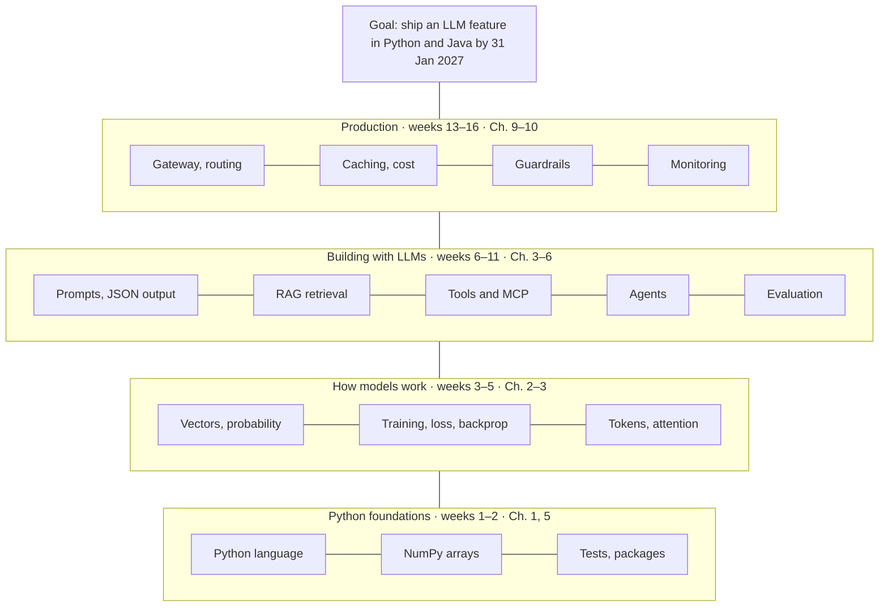
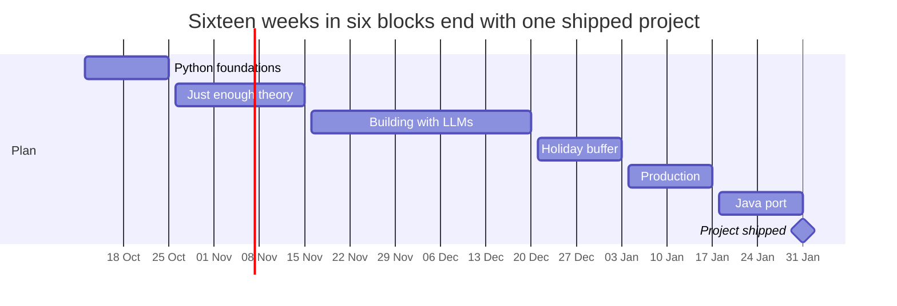

# From Java Engineer to AI Engineer: Your 16-Week Plan

As of 8 October 2026 · Online version: https://claude.ai/code/artifact/04d2dde9-1ae0-415a-8ad5-4a3d3553d6b6

Files in this folder:

| File | What it is |
| --- | --- |
| `AI Engineering.pdf` | The book (Chip Huyen). Page numbers below are the printed page numbers |
| `AI-Engineering-Plan.md` | This plan |
| `python-docs/Python-for-Java-Developers.html` | Your Python guide for weeks 1–2. Open it in a browser |
| `python-docs/Python-3.13-Tutorial.pdf` | The official Python tutorial as a PDF |
| `python-docs/Python-asyncio-overview.pdf` | Official async/await overview (weeks 9–10) |
| `python-docs/official-html/index.html` | The complete official Python 3.13 docs, offline |

---

## Verdict: yes, you are on the right track

The book plus a focused slice of the repo is a good path for you, and it adds to your 15 years of Java instead of replacing them. Done part-time (8 to 10 hours a week), it takes 16 weeks: Monday 12 October 2026 to Sunday 31 January 2027.

**Why it adds up for you**

- **The work companies are short on is engineering, not research.** Most AI work today is building products on top of models from Anthropic, OpenAI or Google, not training new models. That is software engineering with one unpredictable component.
- **Your experience is what goes wrong in AI projects.** Prototypes are easy; reliability, security, cost, monitoring and integration with existing systems are hard. Those are the skills a senior backend engineer already has.
- **Java is a real advantage in enterprises.** Banks, insurers, telecoms and governments run on the JVM. Spring AI and LangChain4j bring LLMs into that world, and few people know both sides.
- **The book is the right one.** Chip Huyen's *AI Engineering* is about building applications on existing models, which is exactly the role you are aiming for.

**Honest risks**

- **The repo is huge (about 1,100 hours) and uneven.** Following it front to back is why you feel lost. This plan uses about 50 of its 523 lessons.
- **Your quiz score was 2/10, but that is not a problem.** The 8 you missed were theory (math, classic ML, neural networks), and this plan covers just enough of it. The 2 you got right were the applied questions, which is your target.
- **Python is a must.** Almost all AI tooling is Python-first. You will use Java at the end, not instead.

**Alternatives, and why not**

| Option | Fits you? | Why |
| --- | --- | --- |
| ML research or data science | No | 1 to 2 years of math and statistics; throws away most of your experience |
| Generic online AI courses | Partly | Good for an overview, but they rarely go deep on production work |
| Stay pure Java and ignore AI | No | AI features are becoming part of normal backend work; you would fall behind |
| **Book + focused repo + Java project** | **Yes** | **Builds on what you know and ends with a portfolio project** |

---

## The goal

By 31 January 2027 you can design, build and run an LLM-powered feature in production, in Python and in Java, and you have one finished project to prove it.

**The role: Applied AI Engineer** (also called AI Engineer, LLM Engineer or AI Platform Engineer). The model is a service you call, much like a database or a payment API. Your job is everything around it:

- **Feeding it the right information:** prompts, context, and retrieval from company data (RAG).
- **Letting it act:** tools, function calling, MCP servers, agents.
- **Knowing whether it works:** evaluation, test sets, LLM-as-judge.
- **Running it safely and cheaply:** guardrails, gateways, caching, routing, monitoring, cost control.

**What you will have at the end**

1. A Python project: a document Q&A service that answers questions with citations, with tests and an evaluation set.
2. The same service rebuilt in Java with Spring AI or LangChain4j, behind a REST API with logging, caching and a cost dashboard.
3. A short write-up: architecture, evaluation results, cost per request, what failed and how you fixed it. This is what you show in interviews or to your manager.
4. Enough understanding of how models work to talk confidently with ML specialists and spot nonsense from vendors.

**What you will not become** (and do not need to): an ML researcher who trains models or designs neural networks from scratch.

---

## What you are learning

You are learning to build one thing: a reliable application around a language model. Every week adds one layer to it, from the bottom up.



The top two layers are the job itself; the bottom two are what make them make sense.

**How the three sources fit together**

- **The book explains why.** It gives you the reasoning and trade-offs, with no code. Read it first each week.
- **The repo shows how.** Small runnable programs that make each idea concrete. Run them, change them, break them.
- **Your own code proves it.** Each week ends with something you built in `ai-journey`, and the plan ends with a real project in Python and Java.

**The words you will meet most**

| Term | Plain meaning | Java analogy |
| --- | --- | --- |
| LLM / foundation model | A model that predicts the next token of text | An external service you call, like a payment API |
| Token | A chunk of text, about 3/4 of a word; you pay per token | A billing unit, like bytes on a network plan |
| Prompt / context | Everything you send the model in one request | The request body |
| Embedding | A list of numbers representing meaning; similar text gives similar numbers | A hash, except similar inputs land close together |
| RAG | Find relevant documents first, then put them into the prompt | Query the database, then render the template |
| Tool / function calling | The model asks your code to run a function and reads the result | A callback the model chooses to invoke |
| MCP | A standard protocol for exposing tools and data to models | JDBC for AI tools |
| Agent | A loop: the model decides, calls a tool, reads the result, repeats | A state machine whose transitions are chosen by the model |
| Evaluation (evals) | Test sets and scoring for model output | Unit and integration tests for non-deterministic code |
| Guardrails | Checks on input and output (safety, format, data leaks) | Input validation and output filters |

---

## Setup on Windows and Mac

Set up once per machine and keep your own work in Git, so the two machines stay in sync. On Windows the command is `python`; on Mac it is `python3`. Everything else is the same.

**1. Get the tools**

| Step | Windows (PowerShell) | Mac (Terminal) |
| --- | --- | --- |
| Check Python (3.12 or newer) | `python --version` | `python3 --version` |
| Install if missing | Download from python.org, tick "Add to PATH" | `brew install python@3.13 git` |
| Editor | VS Code + the Python extension | VS Code + the Python extension |

**2. Fork the curriculum** (fork once on GitHub, so your progress file syncs between machines)

On github.com/rohitg00/ai-engineering-from-scratch click **Fork**. Then on each machine:

```bash
git clone https://github.com/<your-username>/ai-engineering-from-scratch.git
cd ai-engineering-from-scratch
git remote add upstream https://github.com/rohitg00/ai-engineering-from-scratch.git
```

On Windows you already have a clone at `E:\research\ml-algebra`; you can point it at your fork instead with `git remote set-url origin https://github.com/<your-username>/ai-engineering-from-scratch.git`.

**3. Create a virtual environment** (inside the repo folder)

| Windows (PowerShell) | Mac (Terminal) |
| --- | --- |
| `python -m venv .venv` | `python3 -m venv .venv` |
| `.venv\Scripts\Activate.ps1` | `source .venv/bin/activate` |
| `pip install numpy` | `pip install numpy` |

If Windows refuses to run the activate script, run this once: `Set-ExecutionPolicy -Scope CurrentUser RemoteSigned`. Activate the environment every time you open a new terminal; the prompt then starts with `(.venv)`.

**4. A second repo for your own work.** Create an empty GitHub repo called `ai-journey` for your practice code, notes and projects. Clone it next to the curriculum on both machines.

**5. The commands you will use every week**

| Task | Command |
| --- | --- |
| Run a lesson | `cd phases/<phase>/<lesson>/code` then `python <file>.py` (Mac: `python3`) |
| Run its tests (when there is a `tests` folder) | `python -m unittest discover tests -v` |
| Learn a lesson interactively | `/learn` in Claude Code |
| Find the lesson for a topic | `/course-guide <topic>` |
| Quiz yourself on a phase | `/check-understanding 11` |
| Build a project step by step | `/build-project doc-qa-with-citations` |
| Get curriculum updates | `git fetch upstream` then `git merge upstream/main` |
| Sync your work before switching machines | `git add -A`, `git commit -m "week N"`, `git push`; on the other machine `git pull` |

On Windows, paths use backslashes (`cd phases\01-math-foundations\...`); PowerShell also accepts forward slashes.

**6. API key (from week 6).** Early lessons run offline. When you start calling a real model, create a key at console.anthropic.com and set it as an environment variable. Never commit it.

| Windows | Mac |
| --- | --- |
| `setx ANTHROPIC_API_KEY "sk-..."`, then open a new terminal | add `export ANTHROPIC_API_KEY="sk-..."` to `~/.zshrc`, then `source ~/.zshrc` |

---

## Week-by-week plan

Each week takes 8 to 10 hours: three weekday evenings of about 1.5 hours, plus one 4-hour weekend session. Book pages are the printed page numbers from the table of contents. Repo commands run from the curriculum folder with your `.venv` active; on Mac use `python3` where it says `python`.



The building block (weeks 6–10) is the longest because it is the core of the job; the holiday weeks are a deliberate buffer.

### Block 1: Python and the big picture (weeks 1–2)

**Week 1 · 12–18 Oct · Python foundations**

- **What you learn:** Python syntax and data structures; what AI engineering is and where it sits.
- **Python:** `Python-for-Java-Developers.html` parts 1–4, plus tutorial chapters 3–5 (both in `D:\temp\ai\python-docs`).
- **Book:** Preface (pp. xi–xx) and all of Chapter 1 (pp. 1–47). Read "The AI Engineering Stack" (pp. 35–47) twice; it is the map of everything that follows.
- **Repo:** `cd phases/00-setup-and-tooling/01-dev-environment/code` → `python verify.py` (missing GPU or PyTorch is fine). Read the doc for `00-setup-and-tooling/06-python-environments`.
- **Done when:** `ai-journey/week01/word_count.py` prints the 10 most common words in a text file.

**Week 2 · 19–25 Oct · Python, part 2, and prompting**

- **What you learn:** Classes, dataclasses, type hints, exceptions and tests; how to write prompts that work reliably.
- **Python:** Guide parts 5–8, tutorial chapters 6–9.
- **Book:** Chapter 5, Prompt Engineering (pp. 211–251), all of it.
- **Repo:** `phases/11-llm-engineering/01-prompt-engineering/code` → `python prompt_engineering.py`; `phases/11-llm-engineering/02-few-shot-cot/code` → `python advanced_prompting.py`.
- **Done when:** A small Java utility of yours is rewritten in Python with type hints and at least 5 `unittest` tests.

### Block 2: Just enough theory (weeks 3–5)

**Week 3 · 26 Oct–1 Nov · The math you actually need**

- **What you learn:** Vectors, dot products, cosine similarity, probability. Search and embeddings are vectors, and every model output is a probability.
- **Python:** NumPy basics: arrays, shapes, `@`, broadcasting.
- **Book:** Chapter 2: Training Data (pp. 49–58), then Sampling, Structured Outputs and The Probabilistic Nature of AI (pp. 88–111). Leave pp. 58–88 for week 5.
- **Repo** (in `phases/01-math-foundations/`): `01-linear-algebra-intuition` → `python vectors.py` · `02-vectors-matrices-operations` → `python matrices.py` · `14-norms-and-distances` → `python distances.py` · `06-probability-and-distributions` → `python probability.py`.
- **Done when:** You can compute the cosine similarity of two vectors in NumPy, and you can answer quiz questions 1 and 2.

**Week 4 · 2–8 Nov · How models learn**

- **What you learn:** Training, loss, gradients and backpropagation; how to measure a model; why accuracy can lie.
- **Book:** Chapter 3 pp. 113–118. Skim pp. 118–125 (entropy, perplexity: just know what perplexity measures). Read pp. 125–136 (exact evaluation, introduction to embeddings).
- **Repo:** `phases/02-ml-fundamentals/`: `01-what-is-machine-learning` → `python ml_intro.py` · `09-model-evaluation` → `python evaluation.py` · `17-imbalanced-data` → `python imbalanced.py`. `phases/03-deep-learning-core/`: `01-the-perceptron` → `python perceptron.py` · `03-backpropagation` → `python main.py` · `05-loss-functions` → `python main.py`.
- **Done when:** You can explain in three sentences what backpropagation does and why a 90%-accurate model can be useless.

**Week 5 · 9–15 Nov · Transformers and tokens**

- **What you learn:** Tokens, attention (queries, keys, values), why long prompts cost more and run slower, the KV cache.
- **Book:** Chapter 2: Model Architecture and Model Size (pp. 58–78); skim Post-Training (pp. 78–88).
- **Repo:** `phases/07-transformers-deep-dive/`: `01-why-transformers` → `python main.py` · `02-self-attention-from-scratch` → `python self_attention.py` · `07-gpt-causal-language-modeling` → `python main.py` · `12-kv-cache-flash-attention` → `python main.py`.
- **Checkpoint:** `/check-understanding 7` in Claude Code.
- **Done when:** You can sketch attention on a whiteboard and explain context-window cost to a colleague.

### Block 3: Building with LLMs (weeks 6–10)

**Week 6 · 16–22 Nov · Talking to models properly**

- **What you learn:** Structured JSON output, embeddings, context engineering, using an LLM as a judge.
- **Book:** Chapter 3, AI as a Judge and Comparative Evaluation (pp. 136–156).
- **Repo:** `phases/11-llm-engineering/`: `03-structured-outputs` → `python main.py` · `04-embeddings` → `python embeddings.py` · `05-context-engineering` → `python main.py`.
- **First real API call:** In `ai-journey`, run `pip install anthropic` and call Claude with your API key.
- **Done when:** A script sends a prompt to a real model and parses the reply into a validated dataclass.

**Week 7 · 23–29 Nov · RAG (answering from your own documents)**

- **What you learn:** Chunking, retrieval, hybrid search, reranking, why RAG fails.
- **Book:** Chapter 6, RAG (pp. 253–275).
- **Repo:** `phases/05-nlp-foundations-to-advanced/23-chunking-strategies-rag` → `python main.py` · `phases/11-llm-engineering/06-rag` → `python main.py` · `phases/11-llm-engineering/07-advanced-rag` → `python main.py`.
- **Done when:** A small RAG script answers questions over 20 non-confidential documents of your choice.

**Week 8 · 30 Nov–6 Dec · Function calling, evaluation, project start**

- **What you learn:** How models call your code; how to build an evaluation set and pipeline.
- **Book:** Chapter 4, Evaluate AI Systems (pp. 159–208). Skim Navigate Public Benchmarks (pp. 191–200).
- **Repo:** `phases/11-llm-engineering/09-function-calling` → `python function_calling.py`, then `python -m unittest discover tests -v` · `phases/11-llm-engineering/10-evaluation` → `python eval_framework.py`.
- **Project, from the repo root:** `python scripts/project_test.py doc-qa-with-citations --init my-doc-qa`, then build stages 1–2 with `/build-project doc-qa-with-citations`. Check a stage with `python scripts/project_test.py doc-qa-with-citations --stage 1 --path my-doc-qa`.
- **Done when:** Stages 1–2 pass, and you have a 20-question evaluation set for your week-7 RAG.

**Week 9 · 7–13 Dec · Tools and MCP**

- **What you learn:** Tool design, the Model Context Protocol, writing your own MCP server.
- **Book:** Chapter 6, Agents (pp. 275–305).
- **Repo:** `phases/13-tools-and-protocols/`: `01-the-tool-interface` → `python main.py` · `05-tool-schema-design` → `python main.py` · `06-mcp-fundamentals` → `python main.py` + tests · `07-building-an-mcp-server` → `python main.py` + tests.
- **Done when:** Your own MCP server exposes two tools (for example, queries over a sample database) and Claude Code can call them.

**Week 10 · 14–20 Dec · Agents**

- **What you learn:** The agent loop, workflow patterns, how agents fail, prompt injection.
- **Book:** Reread Chapter 5, Defensive Prompt Engineering (pp. 235–251).
- **Repo:** `phases/14-agent-engineering/`: `01-the-agent-loop`, `06-tool-use-and-function-calling`, `12-anthropic-workflow-patterns`, `26-failure-modes-agentic`, `27-prompt-injection-defense`; each → `python main.py`.
- **Done when:** You have an agent loop of under 200 lines with two tools and a turn limit, plus notes on five failure modes you saw.

### Block 4: Holiday buffer (weeks 11–12)

**Week 11 · 21–27 Dec · Light week: orchestration**

- **Repo:** `phases/14-agent-engineering/28-orchestration-patterns` and `30-eval-driven-agent-development`; each → `python main.py`.
- **Book:** Chapter 7, When to Finetune only (pp. 311–319).
- **Otherwise:** Catch up on anything that slipped.

**Week 12 · 28 Dec–3 Jan · Rest and review**

- Take the week off if you need it. Optional: `/check-understanding 11`, reread Chapter 1 pp. 35–47 (notice how much more it says now), and write a one-page scope for your capstone.

### Block 5: Production, your edge (weeks 13–14)

**Week 13 · 4–10 Jan · From script to service**

- **What you learn:** Caching, cost, guardrails, the architecture of a production LLM app.
- **Book:** Chapter 10 (pp. 449–474): enhance context, guardrails, router and gateway, caches, agent patterns, monitoring, orchestration.
- **Repo:** `phases/11-llm-engineering/`: `11-caching-cost` → `python caching_cost.py` · `12-guardrails` → `python guardrails.py` · `13-production-app` → `python production_app.py` · `15-prompt-caching` → `python main.py`.
- **Project:** Finish stages 3–4, then `python scripts/project_test.py doc-qa-with-citations --all --strict --path my-doc-qa`.
- **Done when:** All four project stages pass.

**Week 14 · 11–17 Jan · Running AI in production**

- **What you learn:** Latency and throughput metrics, observability, semantic caching, model routing, gateways, SRE and cost control for AI.
- **Book:** Chapter 9 pp. 405–419 (inference overview and metrics); skim pp. 426–447. Chapter 10, User Feedback (pp. 474–492).
- **Repo:** `phases/17-infrastructure-and-production/`: `13-llm-observability`, `14-prompt-semantic-caching`, `16-model-routing`, `19-ai-gateways`, `23-sre-for-ai`, `27-finops-llms`; each → `python main.py`.
- **Done when:** You write a one-page design for running your document Q&A in production: gateway, cache, routing, monitoring, cost per request.

### Block 6: Bring it home to Java (weeks 15–16)

**Week 15 · 18–24 Jan · Java port, part 1**

- **What you build:** A Spring Boot service with Spring AI (or LangChain4j): a chat client, structured output, embeddings into a vector store (PGVector), and a REST endpoint that answers with citations.
- **Book:** Epilogue (p. 495).
- **Done when:** The Java service answers questions over your documents with citations.

**Week 16 · 25–31 Jan · Java port, part 2, and ship it**

- **What you build:** The evaluation set running as JUnit tests in CI, response caching, token and cost logging, and an input guardrail.
- **Done when:** The repo is public with a README (architecture, evaluation results, cost per request), you have recorded a 5-minute demo, and your CV and LinkedIn mention the project.

---

## Plan at a glance: book, repo and Python by week

Everything in the original rough outline is covered; this plan spreads it over 16 weeks and adds the project, the Java port and a holiday buffer.

| Weeks | Topic | Python | Book | Repo |
| --- | --- | --- | --- | --- |
| 1 | Python basics, big picture | Guide parts 1–4 · tutorial ch 3–5 · word counter | Preface · Ch 1 (all) | Phase 0: 01, 06 |
| 2 | Python, part 2; prompting | Guide parts 5–8 · tutorial ch 6–9 · port a Java tool with tests | Ch 5 (all) | Phase 11: 01, 02 |
| 3 | The math you need | NumPy basics: arrays, `@`, broadcasting | Ch 2 pp. 49–58, 88–111 | Phase 1: 01, 02, 06, 14 |
| 4 | How models learn | NumPy practice through the lessons | Ch 3 pp. 113–136 | Phase 2: 01, 09, 17 · Phase 3: 01, 03, 05 |
| 5 | Transformers and tokens | — | Ch 2 pp. 58–88 | Phase 7: 01, 02, 07, 12 |
| 6 | Structured output, embeddings, LLM as judge | First real API call (`anthropic` SDK), JSON into dataclasses | Ch 3 pp. 136–156 | Phase 11: 03, 04, 05 |
| 7 | RAG | Files, chunking text, a small RAG script | Ch 6 pp. 253–275 | Phase 5: 23 · Phase 11: 06, 07 |
| 8 | Function calling and evaluation | `unittest` for a 20-question eval set | Ch 4 (all) | Phase 11: 09, 10 · project stages 1–2 |
| 9 | Tools and MCP | `async`/`await` for your MCP server | Ch 6 pp. 275–305 | Phase 13: 01, 05, 06, 07 |
| 10 | Agents | An agent loop under 200 lines | Ch 5 pp. 235–251 (reread) | Phase 14: 01, 06, 12, 26, 27 |
| 11 | Orchestration (light week) | Catch up | Ch 7 pp. 311–319 | Phase 14: 28, 30 |
| 12 | Review and rest | — | Ch 1 pp. 35–47 (reread) | `/check-understanding 11` |
| 13 | Production architecture | Finish the project in Python | Ch 10 pp. 449–474 | Phase 11: 11, 12, 13, 15 · project stages 3–4 |
| 14 | Running in production | — | Ch 9 pp. 405–447 · Ch 10 pp. 474–492 | Phase 17: 13, 14, 16, 19, 23, 27 |
| 15–16 | Java port and ship | Java: Spring AI or LangChain4j, JUnit evals | Epilogue | Your own service, public on GitHub |
| Later | Only if you need them | — | Rest of Ch 7 · Ch 8 | Phases 10, 15, 16, 18 |

---

## What to skip, and why

Skipping is part of the plan, not a shortcut. Everything here can wait until a real project needs it.

**In the book**

| Part | Pages | Decision | Why |
| --- | --- | --- | --- |
| Ch 3: entropy, cross entropy, bits-per-byte | 118–125 | Skim | Only know what perplexity means |
| Ch 4: Navigate Public Benchmarks | 191–200 | Skim | Benchmark names change every few months |
| Ch 7: Finetuning, except "When to Finetune" | 307–310, 319–361 | Skip | Most applications never need it; read pp. 311–319 to know when they do |
| Ch 8: Dataset Engineering | 363–403 | Skip for now | Matters when you build training data; come back after the plan |
| Ch 9: AI Accelerators | 419–426 | Skip | GPU hardware is a platform-team concern |
| Ch 9: Model and service optimization | 426–447 | Skim | Know the words (quantization, batching); details belong to serving teams |

**In the repo** (about 470 of 523 lessons)

| Phases | Decision | Why |
| --- | --- | --- |
| 0 Setup (except lessons 01 and 06) | Skip | GPU, Docker and Linux are things you already know or don't need yet |
| 1–3 (except the lessons in weeks 3–4) | Skip | Theory beyond what an application engineer uses |
| 4 Vision, 6 Speech, 8 Generative images, 9 Reinforcement learning, 12 Multimodal | Skip | Different specialties |
| 5 NLP (except 23, chunking) | Skip | Mostly pre-LLM techniques |
| 10 LLMs from Scratch | Later | Excellent, but only after the plan, if you get curious |
| 13–14 (except the lessons in weeks 9–11) | Later | Pick specific lessons with `/course-guide` when a project needs them |
| 15–16 Autonomous and multi-agent systems | Later | Advanced; build one solid agent first |
| 18 Ethics and safety | Later | Worth reading after week 16, especially for regulated industries |
| 19 Capstones (86 projects) | Pick one | A catalog to choose from, not a list to finish |

---

## Extra research and resources

Use these alongside the plan, in the week shown. Every link was checked on 8 October 2026.

| When | Resource | What it gives you |
| --- | --- | --- |
| Weeks 1–2 | [The Python Tutorial](https://docs.python.org/3/tutorial/) (offline copy in `python-docs`) | The official language tour; chapters 3–9 are enough |
| Week 3 | [NumPy: the absolute basics](https://numpy.org/doc/stable/user/absolute_beginners.html) | Arrays and shapes, the base of all AI code |
| Weeks 4–5 | [3Blue1Brown: Neural networks](https://www.3blue1brown.com/topics/neural-networks) | Visual explanations of learning, backprop and transformers |
| Week 5 | [The Illustrated Transformer](https://jalammar.github.io/illustrated-transformer/) | Attention explained with pictures |
| Week 5 | Andrej Karpathy, "Intro to Large Language Models" (YouTube, about 1 hour; search the title) | How LLMs are trained and why they behave the way they do |
| Any week | [Book companion repo](https://github.com/chiphuyen/aie-book) | Chip Huyen's extra resources and chapter notes |
| Week 6 | [Claude Platform docs](https://docs.claude.com) | API, tool use, prompt caching, structured output |
| Week 6 | [Claude Academy](https://www.anthropic.com/learn) | Free hands-on courses on building with Claude |
| Week 8 | [Your AI Product Needs Evals](https://hamel.dev/blog/posts/evals/) (Hamel Husain) | The most practical guide to evaluation |
| Week 9 | [Model Context Protocol](https://modelcontextprotocol.io) | The official MCP spec and guides |
| Weeks 10–11 | [Building Effective AI Agents](https://www.anthropic.com/engineering/building-effective-agents) (Anthropic) | When to use workflows versus agents; the patterns in one read |
| Week 13 | [Patterns for Building LLM-based Systems](https://eugeneyan.com/writing/llm-patterns/) (Eugene Yan) | Production patterns that match Chapter 10 |
| Weeks 15–16 | [Spring AI reference](https://docs.spring.io/spring-ai/reference/) | LLMs in Spring Boot: chat, RAG, tools, vector stores |
| Weeks 15–16 | [LangChain4j docs](https://docs.langchain4j.dev/) | The alternative Java library; compare and pick one |
| Weekly, 30 min | [Simon Willison's Weblog](https://simonwillison.net) and [Latent Space](https://www.latent.space) | Staying current without drowning in hype |

**Research you can do at work.** List three repetitive, text-heavy tasks in your company (support tickets, internal documents, code reviews, reports). By week 8, pick one as your real project; it makes the Java port in weeks 15–16 something your manager can see.

---

## Staying on track

Feeling lost usually means the next step is too big or too vague. The fix is a fixed weekly routine and small, visible wins.

**The weekly routine**

| Session | Time | What you do |
| --- | --- | --- |
| Tuesday evening | 1.5 h | Book reading for the week, with notes |
| Wednesday evening | 1.5 h | Python practice or the first repo lessons |
| Thursday evening | 1.5 h | Remaining repo lessons: run, read, change one thing, run again |
| Saturday or Sunday | 4 h | The week's "Done when" deliverable, then commit and push |

**Rules that keep you moving**

- **Change one thing in every lesson.** Running code teaches little; changing a number or a prompt and predicting the result teaches a lot.
- **Write three lines per book session:** what it said, what surprised you, how it applies to your Java systems. These notes become your interview stories.
- **Never skip twice.** Missing one session is normal. If you miss two in a row, do just 20 minutes the next day to keep the chain going.
- **Stuck for more than 30 minutes?** Ask Claude Code (`/course-guide <topic>` or just describe the problem), then move on.
- **Behind schedule?** Weeks 11–12 are a buffer. If you are more than two weeks behind, drop the "Skim" items rather than stretching the plan.

**Checkpoints**

- [ ] Week 2, 25 Oct: Python feels readable; Java utility ported with tests
- [ ] Week 5, 15 Nov: `/check-understanding 7` passed; can explain tokens and attention
- [ ] Week 8, 6 Dec: first real model call, a RAG script, and project stages 1–2 passing
- [ ] Week 10, 20 Dec: own MCP server and agent loop working
- [ ] Week 14, 17 Jan: all project stages passing; production design written
- [ ] Week 16, 31 Jan: Java service public on GitHub with README and demo

**Retake the placement quiz** (`/find-your-level`) at weeks 5 and 16. Your score was 2/10 on 8 October; seeing it rise is a good reminder that the plan is working.
